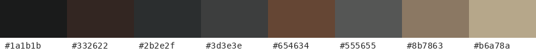
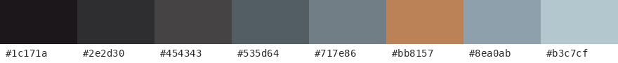
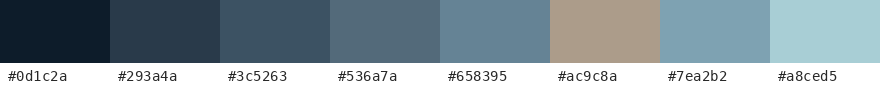
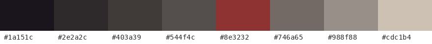
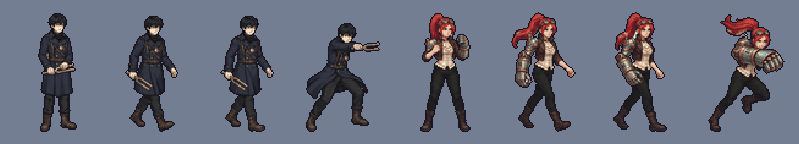
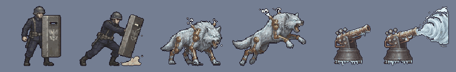
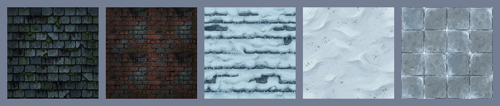
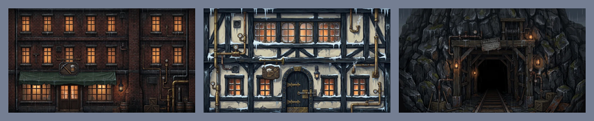
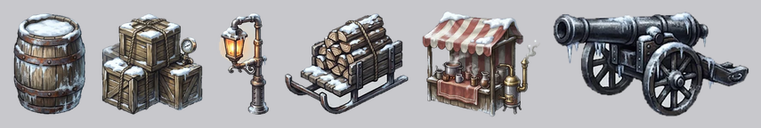
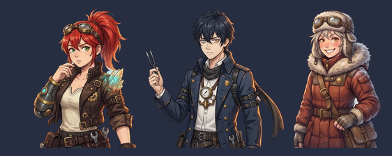

# 美術規範｜鐵與灰的等價律

這份規範記錄目前遊戲裡已採用素材的共同特徵，以及生圖時踩過的坑。之後每次生新圖都照這份寫 prompt，第三章的素材才會和前兩章看起來像同一套美術。

---

## 一、整體風格

- **參考作品**：八方旅人（Octopath Traveler）的 HD-2D：點陣角色站在有材質、有光影的立體場景裡。
- **世界觀關鍵字**：蒸汽龐克、鍊金術、礦業小鎮、北境要塞。黃銅、鉚釘、蒸氣管、煤灰、霜。
- **調性**：沉穩、有點憂鬱，但每個場景都有一處溫暖的光源（燈籠、爐火、窗光）。**不要**明亮飽和的卡通色。

## 二、色盤

色盤是從已採用的素材自動取樣的。新素材的主色請落在對應章節的色盤附近。

| 場景 | 色盤 | 說明 |
|---|---|---|
| 第一章・奧姆鎮 |  | 煤灰黑、鏽褐、濕石板灰，點綴琥珀色燈光 |
| 第二章・北境 |  | 鋼藍、霜白、灰藍，點綴黃銅與暖橘窗光 |
| 冰封記憶庫 |  | 深海藍、冰青，點綴冷白光 |
| 角色 |  | 深色服裝為主，靠髮色與單一重點色辨識（克蕾雅的紅髮） |

**光源方向**：場景圖的主光從**左上**來；材質圖則要**均勻打光、無陰影**（光影由遊戲引擎負責）。

## 三、各類素材規格

| 類型 | 比例 | 背景 | 角度 | 遊戲內處理 |
|---|---|---|---|---|
| 立繪（對話） | 半身，約 3:4 | 純淺灰 | 正面略側 | 去背、裁到腰部、高 560px |
| 點陣角色 | 16:9，姿勢橫排 | 純淺灰 | 3/4 俯視，**朝右** | 去背、縮成 96px 高、限色、加外框 |
| 敵人 | 16:9，待機＋攻擊 | 純淺灰 | 3/4 俯視，**朝右** | 同上，Boss 可到 150px |
| 地面／牆面材質 | 1:1 | — | 地面正上方、牆面正對 | 512px、四邊可拼接 |
| 建築正面／地標 | 依實際比例 | — | 正對、無透視、滿版 | 依牆面寬高裁切 |
| 小物件 | 16:9，3×2 排列 | 純淺灰 | 3/4 正面 | 自動切成 6 個、去背 |
| 劇情背景 | 16:9 | — | 電影鏡頭 | 鋪滿畫面，不放人物 |

### 參考範例（已採用）

點陣角色：

敵人：

材質（屋瓦、紅磚、雪屋頂、雪地、要塞地板）：

建築正面與地標：

小物件：

立繪：

---

## 四、Prompt 範本

### 點陣角色（主角、NPC、路人）

> Pixel art game sprite sheet in the style of Octopath Traveler HD-2D, chunky readable pixels, limited color palette, clean dark outline. Full body, slight top-down three-quarter view. EVERY pose faces to the RIGHT side of the image. The SAME character in every pose: identical design, colors and scale, all feet at the same height. Three poses arranged left to right in a single row with wide empty space between them: 1) standing idle, 2) walking LEFT-FOOT-FORWARD, 3) walking RIGHT-FOOT-FORWARD. In pose 2 the left leg steps forward while the right arm swings forward; in pose 3 the right leg steps forward while the left arm swings forward — poses 2 and 3 must be clear mirror opposites, never the same stance. Plain flat light grey background. NO ground line, NO floor, NO shadows, NO text, NO labels.
>
> （接角色描述）

主角要加第 4 個姿勢「攻擊」；拿道具的角色加一句 **Only ONE [道具] in his right hand in every pose.**

### 主角四格走路（獨立一張，env/ch_<名字>_walk.webp）

附上參考圖（待機＋攻擊兩格），再貼：

> Pixel art game sprite sheet in the style of Octopath Traveler HD-2D, chunky readable pixels, limited color palette, clean dark outline. Use the attached image as the character reference: identical face, hair, outfit, colors and proportions. Full body, slight top-down three-quarter view, EVERY pose faces to the RIGHT. A 4-frame WALK CYCLE arranged left to right in a single row with wide empty space between them, same scale, all feet at the same height: 1) CONTACT A — left leg stepping far forward with the heel down, right leg stretched behind on its toes; right arm swings forward, left arm back. 2) PASSING A — left foot flat under the body carrying the weight, right knee lifted and passing beside it; arms close to the body; body slightly higher. 3) CONTACT B — the exact opposite of pose 1: right leg forward heel down, left leg behind; left arm forward, right arm back. 4) PASSING B — the exact opposite of pose 2: right foot under the body, left knee lifted. Poses 1 and 3 must be clearly opposite stances, and so must poses 2 and 4. Plain flat light grey background. NO ground line, NO floor, NO shadows, NO text, NO labels, NO numbers.

遊戲會用「1→2→3→4」循環播放；沒有這張圖時，退回舊的「待機／走A／待機／走B」。

### 敵人

同上的開頭，改成 **Two poses: 1) idle, 2) attacking to the right.**，並**刪掉走路那段**。

### 材質（可拼接）

> Seamless tileable texture of [材質], viewed exactly [from above / straight-on], evenly lit with no shadows or vignette. [細節]. Muted [章節色調] palette. Painterly pixel-art HD-2D game texture, must tile seamlessly on all four edges.

### 建築正面／地標

> Perfectly flat, straight-on orthographic front view of [建築], used as a game texture. Fills the ENTIRE image edge to edge: no sky, no ground, no perspective. [細節]. Painterly pixel-art HD-2D style like Octopath Traveler, [章節色調] palette.

### 小物件

> Six separate game prop sprites arranged in a 3×2 grid on a plain flat light grey background, each object fully separated with generous empty space between them, no shadows on the background. [主題]: [六個物件]. Each shown from a slight three-quarter front view. Painterly pixel-art HD-2D style like Octopath Traveler.

### 立繪

> Anime-style JRPG character portrait, waist-up, facing slightly left, plain flat light grey background, no text, clean silhouette, painterly HD-2D game art style, [章節色調] palette. Generate [N] versions with identical clothing and pose, differing only in facial expression: ...

### 劇情背景

> Wide painterly background illustration with no characters: [場景]. Cinematic HD-2D style like Octopath Traveler, [光線與色調].

---

## 五、生成後的檢查清單

傳圖前請先看一眼：

- [ ] 背景是**純淺灰**，沒有漸層、地面、影子
- [ ] 沒有**文字或標籤**（IDLE、SWINGING 之類）
- [ ] 腳下沒有**地面線**
- [ ] 角色全部**朝右**
- [ ] 走路兩格**左右腳相反**
- [ ] 同一張裡的角色**長相、服裝、大小一致**（沒有多出武器、沒有少掉機械臂）
- [ ] 材質圖**沒有暗角**、四邊接得起來
- [ ] 建築正面**沒有透視**、沒有天空

## 六、踩過的坑

| 問題 | 發生在 | 解法 |
|---|---|---|
| 圖下方出現英文標籤 | 敵人第一版 | prompt 加 NO text, NO labels（工具也會自動裁掉） |
| 地面線把姿勢黏在一起、去背時把腳一起裁掉 | NPC 第一版 | prompt 加 NO ground line（工具改用空白欄位切開） |
| 兩格走路同一隻腳在前 | 主角、NPC | 寫明左右手腳的對應，並要求兩格互為鏡像 |
| 萊恩兩手各拿一把音叉 | 萊恩第二版 | 加 Only ONE tuning fork in his right hand |
| 克蕾雅待機時機械臂消失 | 克蕾雅第二版 | 加 Her RIGHT arm is the mechanical gauntlet in every pose |
| 白色／淺色物件和背景一起被去掉 | 雪狼、晶化士兵、歐瑞克 | 工具可調去背容許度；生成時背景改成中灰也有幫助 |
| 方向不一致 | 巡邏犬、雪狼 | prompt 寫 EVERY pose faces RIGHT（工具可逐格翻轉） |
| 雪地太亮、和可移動格子混在一起 | 第二章地面 | 色調寫 muted blue-grey, not bright white |

## 七、檔案命名

| 前綴 | 內容 | 資料夾 |
|---|---|---|
| `ch_` | 點陣角色／敵人精靈表 | `env/` |
| `tx_` | 可拼接材質 | `env/` |
| `oh_`、`fp_`、`ft_`、`gl_` | 各地圖的建築正面 | `env/` |
| `lm_` | 地標 | `env/` |
| `pr_` | 小物件 | `env/` |
| `bg_` | 劇情背景 | `env/` |
| `角色_表情` | 立繪 | `portraits/` |
| 原始生成圖 | 編號＋名稱，例如 `E6_wolf.png` | `art_src/` |

轉檔工具：
- 點陣角色：`python3 src/sprite_tool.py <名稱> <原圖> <幀名,逗號分隔> [高度]`
- 立繪去背：`src/cutout.py`
